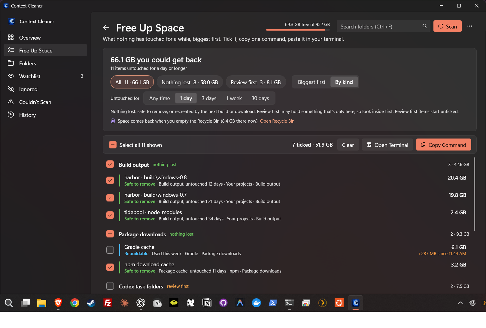
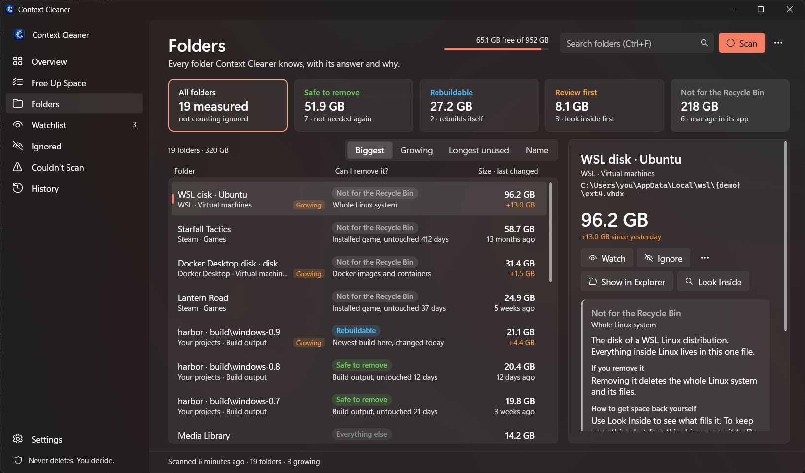
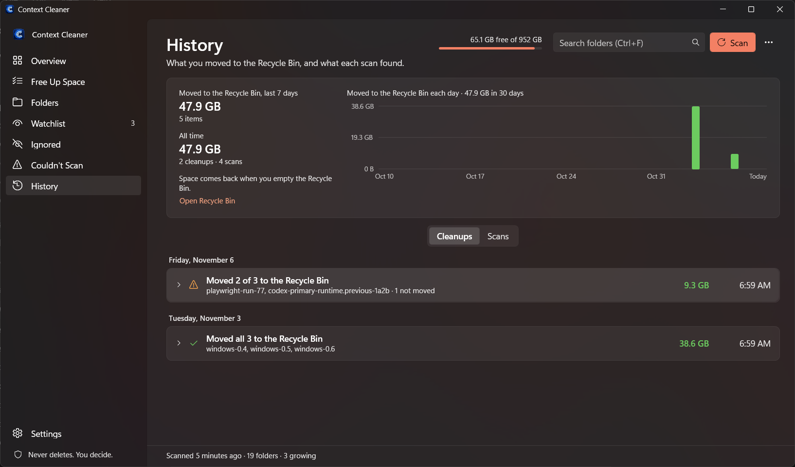
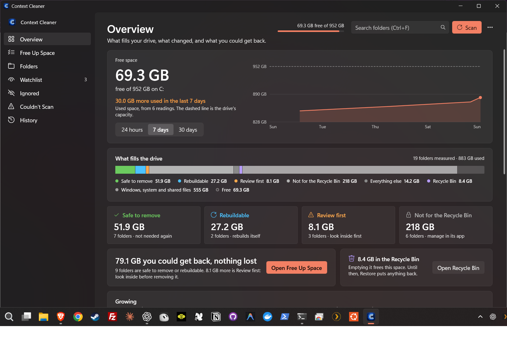
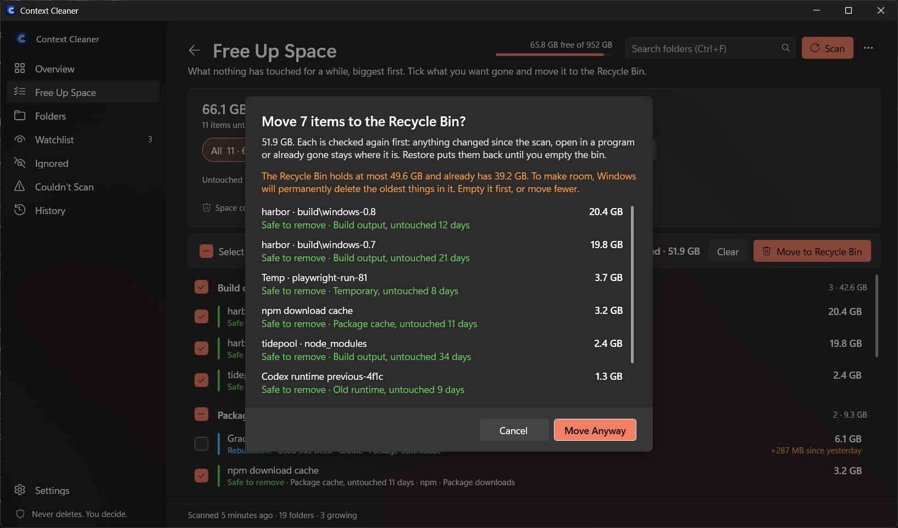
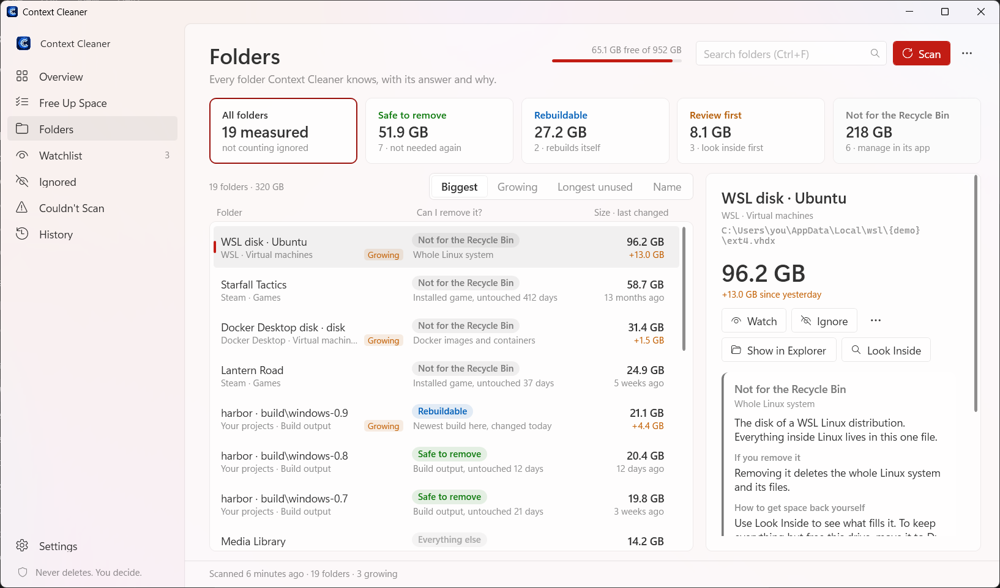

# Context Cleaner for Windows

Find the gigabytes that Codex, build tools, WSL, Docker and games pile up on your Windows drive, and clear them in one go. It shows what each folder is and what removing it costs. **It never deletes a thing:** it moves what you choose to the Recycle Bin, after you confirm, and the space comes back when you empty it.

Nothing to install: it runs on Windows PowerShell, which every Windows 10 and 11 has. It follows Windows' light or dark mode and your accent color, with Mica on Windows 11.



<table>
  <tr>
    <td width="50%"><br><sub><b>Folders.</b> Every folder, its answer and why, with how to get space back yourself.</sub></td>
    <td width="50%"><br><sub><b>History.</b> What you moved to the Recycle Bin, and what each cleanup left alone.</sub></td>
  </tr>
  <tr>
    <td width="50%"><br><sub><b>Overview.</b> What you could get back, free space over time, and what fills the drive.</sub></td>
    <td width="50%"><br><sub><b>Move to Recycle Bin.</b> Confirm in the window; each item is checked again first.</sub></td>
  </tr>
  <tr>
    <td width="50%"><br><sub><b>Light or dark,</b> following Windows.</sub></td>
    <td width="50%"></td>
  </tr>
</table>

<sub>Screenshots use made-up demo folders (windows/Tools/New-DemoData.ps1).</sub>

## Get it

1. Download `Context-Cleaner-…-windows.zip` from the [Windows release](https://github.com/chrissotraidis/contextcleaner/releases/tag/windows-v0.1.0), or clone this repository.
2. Right-click the zip, choose **Properties**, tick **Unblock** and choose **OK**, then extract it anywhere.
3. Double-click **Context Cleaner.cmd**. In **Settings**, turn on **Start menu shortcut** to open it from Start, with its icon and no console window.
4. Choose **Scan**. It reads folder sizes and dates for about a minute and changes nothing.

## How it works

1. **Scan.** It measures the places these tools pile up data (sizes and dates only), and reads git, read-only and offline, for worktrees and build folders.
2. **Answer.** Every folder gets one answer, with the reason, what removing it costs, and how to get the space back yourself.
3. **Free Up Space.** Pick how long something must have sat untouched, filter to **Nothing lost** or **Review first**, list **Biggest first** or **By kind**, and tick what you want gone. Review first items start unticked.
4. **Move to Recycle Bin** (or press Delete). A dialog lists what you ticked, says which are Review first, and warns if the Recycle Bin would overflow. Confirm, and each item is checked again and moved, with progress and a line for each: moved, already gone, or not moved and why. **History** lists every cleanup. Restore works until you empty the bin; that's when the space comes back. To run it yourself instead, choose **… › Copy as Command Instead** and paste it in a terminal.

| Answer | What removing it costs |
|---|---|
| Safe to remove | Nothing. A tool recreates it, or a newer copy exists, and it has sat unused. |
| Rebuildable | You wait for the next build or download to recreate it. |
| Review first | It may hold something that exists only there: task outputs, downloads, recent crashes, a worktree with unpushed work, or a folder of 500 MB or more that a project's git ignores (Not in git, only on this PC). |
| Not for the Recycle Bin | WSL and Docker disks, games, app data, chat history and Windows' own files. The card says how to get space back with their own tools. |
| Everything else | Folders with no rule. **Track This Folder** scans one item by item from then on. |

## What it looks at

Turn any group off in **Settings › Where Context Cleaner looks**.

| Group | Places |
|---|---|
| Codex | `.codex` (conversations, generated images, worktrees), `Documents\Codex` task folders, old runtimes in `.cache\codex-runtimes`, the Codex app's data |
| Claude, AI models | Claude and Claude Code data; Hugging Face, Ollama and LM Studio models |
| Project build folders | `build`, `dist`, `out`, `target`, `node_modules`, `.next`, `obj` and more, in every folder that holds git repositories (found on their own, or set in Settings). As on the Mac, `build` is output by name; any other name counts as output only when the project's git ignores it, and is Review first otherwise. A build folder holding several builds is listed build by build, and the newest is Rebuildable. A git worktree is offered only when git has everything in it. |
| Package caches | npm, pnpm, Yarn, Bun, pip, uv, NuGet, Gradle, Cargo, Go, Playwright, Electron; Android system images and NDKs |
| Temporary files, crash dumps, shader caches | Big items in Temp, and in a Temp folder something still writes to, the files in it that have sat untouched (such as the Remote Desktop client's traces, which pile up by gigabytes a day); crash dumps and error reports; DirectX, NVIDIA and AMD shader caches |
| WSL and Docker | Each Linux distribution's disk, with **Look Inside** listing the biggest folders inside Linux, read-only; Docker Desktop's disks |
| Steam games | Every game in every Steam library, with when Steam says you last played it, and **Uninstall in Steam** on its card |
| Windows | Page and hibernation files, Windows Update downloads, Windows.old, error reports. These are Windows' to clean; their cards open **Settings › Storage**. |
| Downloads | Each big item in Downloads |

## Made for Windows

- **Move instead of delete.** When another drive has room, a game's card says how to move it there with Steam (Settings › Storage › Move, no download), and the WSL card gives the one command that moves Linux: `wsl --manage <distro> --move <folder>`. The Overview lists your drives.
- **WSL and Docker disks never shrink on their own.** Their cards give Microsoft's steps to hand the space back after you delete inside them.
- **Programs running from a folder** are named on its card, and the folder is left out of a command until they quit.
- **The Recycle Bin is part of the picture:** what's waiting in it, its size limit (a command that would overflow it asks first, because Windows would permanently delete the oldest things to make room), and Open Recycle Bin.
- **Growth.** Each scan is compared with the newest one at least 6 hours old. Folders that grew show on the **Watchlist**, with a size-over-time chart on their card. **Scan once a day** (Settings) adds a reading every day through Task Scheduler, in your account, sizes only.

## What a move checks

Move to Recycle Bin and a copied command run the same script, `Move-ToRecycleBin.ps1`, on a list of items Context Cleaner saved. It:

- does nothing if the command is over an hour old;
- refuses to run if the Recycle Bin on the drive is set to delete files immediately;
- checks every item again: anything gone, a link or junction (anywhere along its path), a program running from it, a worktree git no longer vouches for, or anything changed since the scan is left alone;
- only moves things inside your home folder, your Temp folder or a project folder, and never your home folder itself, anything directly in it or in AppData except a known cache, a whole project, `Documents\Codex`, `.ssh`, OneDrive, chat history, or Context Cleaner and its data;
- moves through the Windows Recycle Bin, with Windows' own warning if something is too big for it.

Add `-WhatIf` to a copied command to run every check and see what it would move, without moving anything. A copied command is for PowerShell and quotes its paths so nothing in a folder name is run. Git is only ever read, with hooks, fsmonitor and any filter a repository names (such as Git LFS) switched off.

## Keyboard

| Keys | Does |
|---|---|
| Ctrl+R or F5 | Scan |
| Esc | Stop the scan, or clear the search |
| Ctrl+F | Search |
| Delete | Move what's ticked in Free Up Space, or the selected folders, to the Recycle Bin (asks first) |
| Ctrl+Shift+C | Copy as Command Instead (Free Up Space) |
| Ctrl+E | Export the cleanup list |
| Ctrl+1 … Ctrl+7 | Overview, Free Up Space, Folders, Watchlist, Ignored, Couldn't Scan, History |
| Ctrl+, | Settings |
| Alt+Left, Alt+Right, mouse back and forward | Back and forward between pages |

Right-click any folder for Show in Explorer, Copy Path, Scan Again, Watch for Growth, Its Growth Is Normal, Remind Me Tomorrow, Ignore, Track and Stop Scanning. In Folders, Ctrl+click or Shift+click several folders to see their total and move those that can go in one step. Each folder's card has a note field; search finds folders by their notes.

The window opens where you left it, shows scan progress on its taskbar button, collapses its sidebar to icons when narrow, and follows Windows' high-contrast themes.

## Your data

Scans, plans, settings, readings and History are files in `%LOCALAPPDATA%\Context Cleaner`. No network access, accounts or analytics. A scan from the command line: `powershell -File ContextCleaner.ps1 -Scan`, or with a Markdown cleanup list: `-Report C:\path\report.md`.

## Build and test

```powershell
powershell -NoProfile -ExecutionPolicy Bypass -File windows\Tests\Run-Tests.ps1    # also runs under pwsh
powershell -NoProfile -ExecutionPolicy Bypass -File windows\Build-Release.ps1 -Out C:\new\folder
```

The tests use a throwaway data folder (`CONTEXT_CLEANER_DATA`) and fixtures in Temp; the mover test sends one fixture folder to the Recycle Bin and removes it from there. GitHub Actions runs them on Windows PowerShell 5.1 and PowerShell 7.

| File | Purpose |
|---|---|
| `Context Cleaner.cmd` | Opens the app |
| `ContextCleaner.ps1`, `ContextCleaner.xaml` | The window (WPF), the daily scan and the report |
| `ContextCleaner.Core.ps1` | Places, measuring, answers, git checks and plans. Reads only. |
| `Move-ToRecycleBin.ps1` | The command you run. The only file that moves anything, and only to the Recycle Bin. |

Not on Windows yet: tags (notes are there), and the Mac-only places (Xcode, simulators, Parallels).

